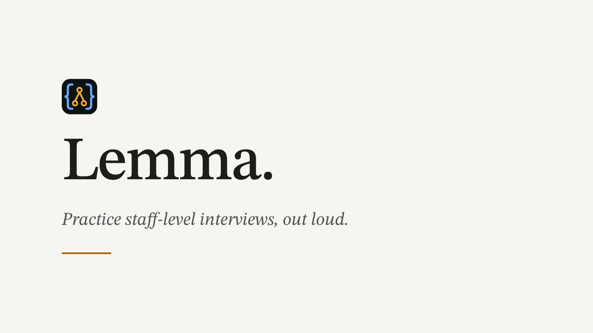
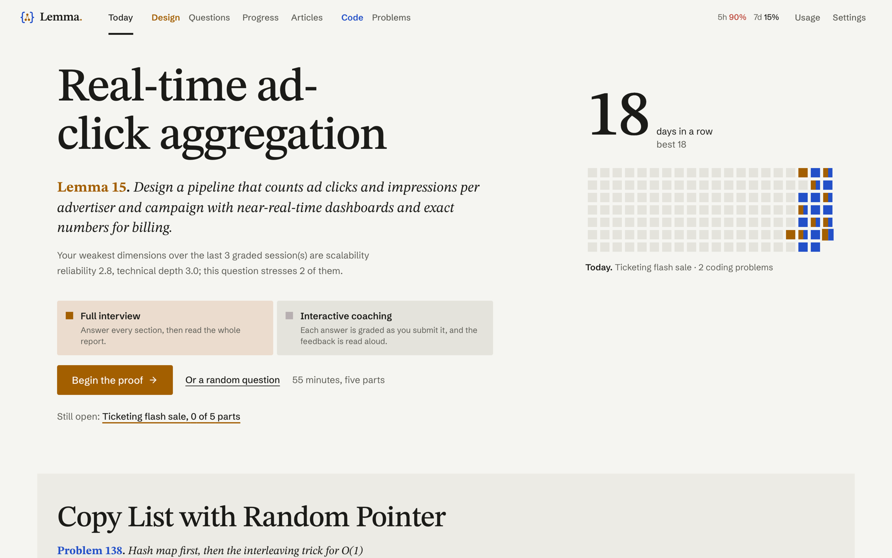
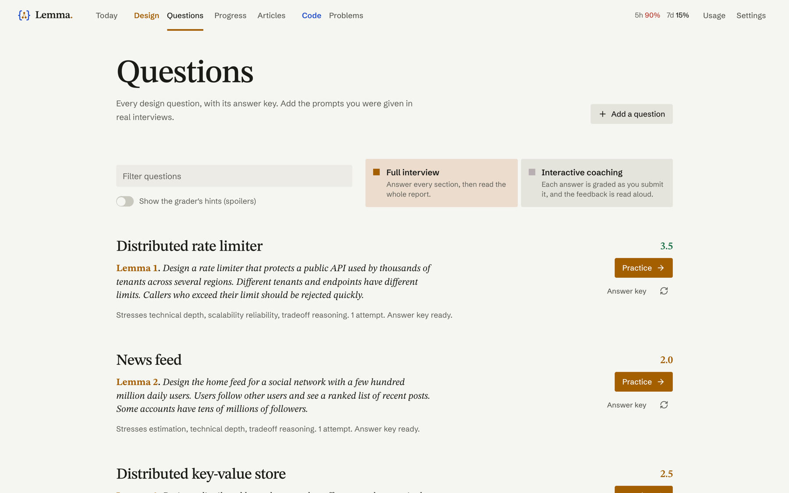
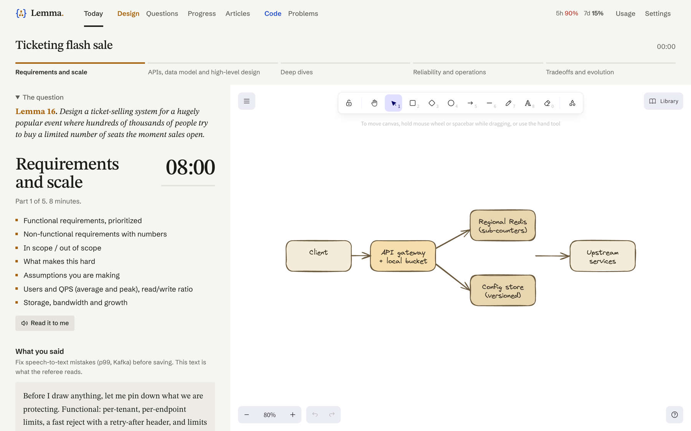
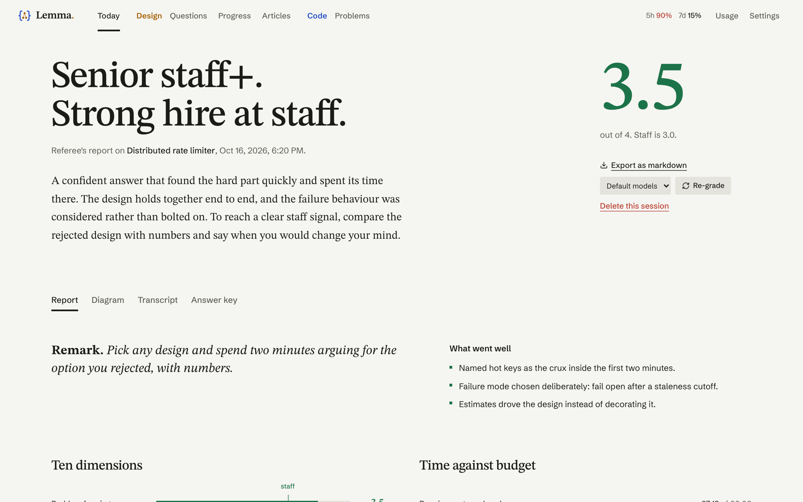
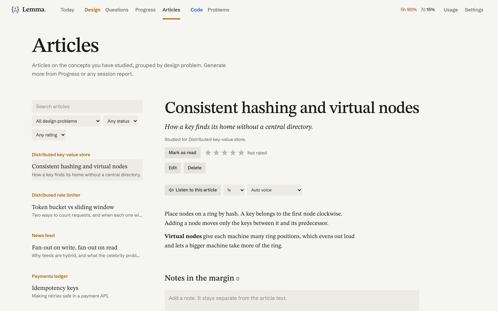
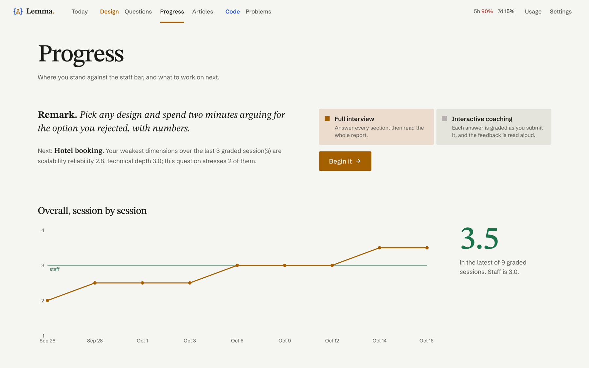
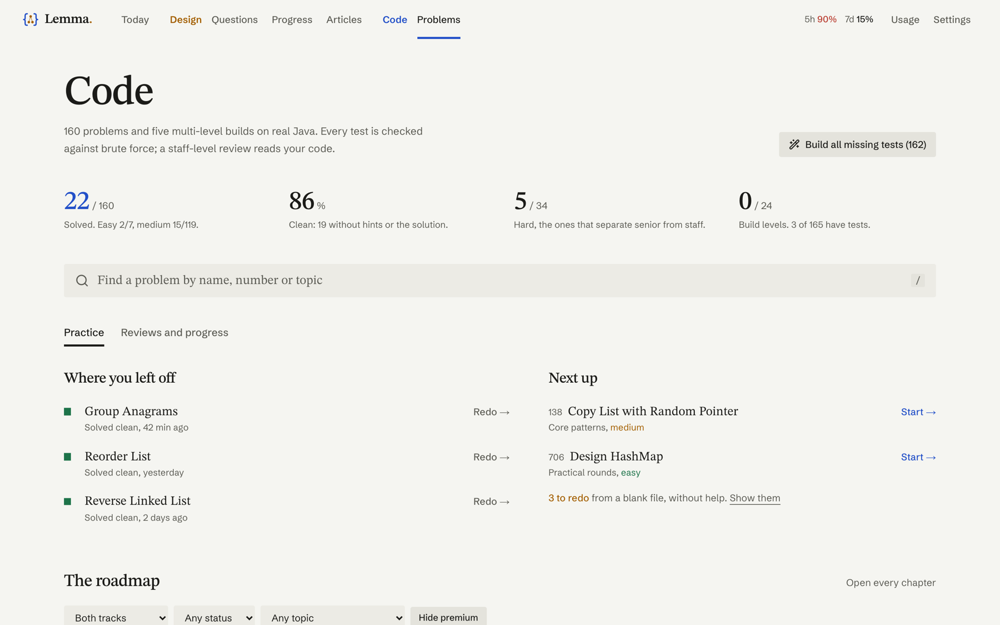
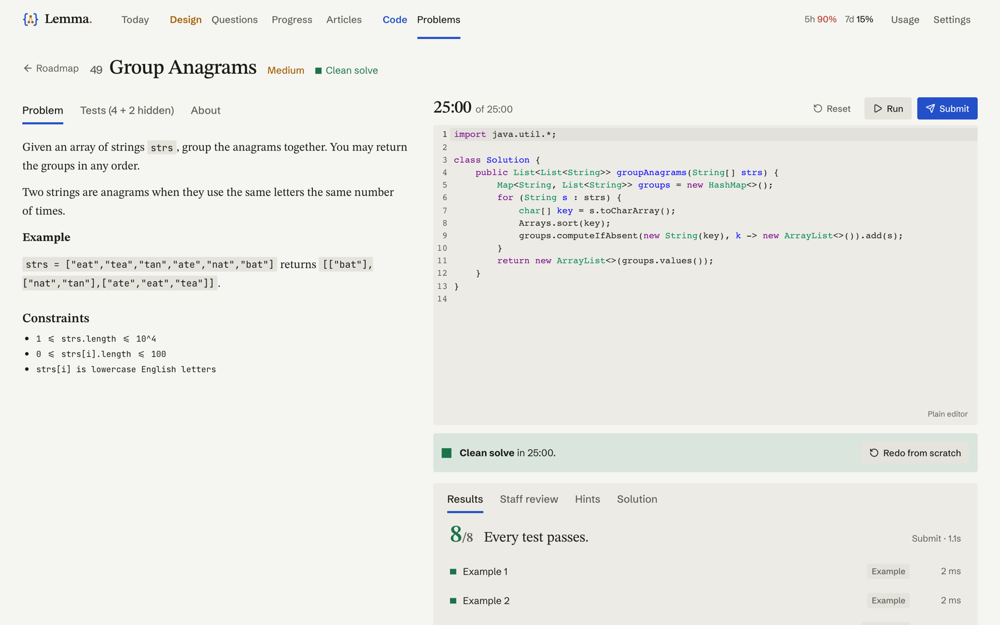

# Lemma

[](https://github.com/rishavpaul/lemma/actions/workflows/ci.yml) [](LICENSE)

*Design out loud. Code under pressure.* A local-only practice app for staff-level interviews, in two tracks that share one
streak, one set of settings and one look:

- **System design.** You answer out loud, section by section, using one fixed five-part framework. Each clip is transcribed locally
  with Whisper, you fix the transcript, and Claude grades it against a web-researched reference brief. A Progress page tracks you
  over many sessions.
- **Coding.** A 160-problem roadmap in Java. Claude builds each problem and its tests once, a local judge runs your code, and a
  staff-level review grades it. The editor has completion, auto-import and live errors through the Java language server.

- Speech-to-text: `mlx-whisper` (`large-v3-turbo`), fully local and free.
- Grading and research: the `claude` CLI in print mode (`claude -p`) through your **Claude Pro subscription**. No API key is
  used; `ANTHROPIC_API_KEY` / `ANTHROPIC_AUTH_TOKEN` are stripped from the subprocess environment.
- Everything is stored under `~/Lemma/`. Both servers bind to `127.0.0.1` only.
- UI: Next.js (App Router) + Tailwind + shadcn/ui in `web/`, with Excalidraw for the diagram canvas. The Python API in `app/` is
  unchanged in role; the browser reaches it through Next's `/api` proxy (`web/next.config.ts`).

[](docs/promo.mp4)

*A two-and-a-half-minute tour (`docs/promo.mp4`). All data shown here is made up; see `scripts/demo_data.py`.*

## Features



- **Speak your answer, section by section.** A timed, five-part staff-level framework (requirements and scale, APIs, data and
  high-level design, deep dives, reliability and ops, tradeoffs). The clock only runs while you record.
- **Local speech-to-text.** Audio is transcribed on your Mac with Whisper; you fix the transcript before it is graded.
- **Draw while you talk.** An Excalidraw canvas whose contents are read by the grader along with your answer.
- **Graded against a researched answer key.** Each question gets a web-researched reference brief; every section gets a score,
  evidence quotes, gaps and follow-up questions, plus an overall level and hire signal.
- **Your choice of model.** Grade with your Claude subscription, or with free OpenRouter and Groq models. Set it per task.
- **Library of questions.** Practice the built-in set, read each answer key, or add prompts from your own interviews.
- **Articles.** Explain with (Sonnet, Opus or free Nemotron) sends a concept plus your article list to the model, which picks an
  existing article or writes a new one. Articles are grouped by design problem; read, edit and ask questions on the Articles page.
- **Progress over time.** Streaks, recurring gaps and a study list that grows from your sessions.
- **Usage tracking.** Calls, tokens, cost and plan-limit use for every model call.



The interview: one section at a time, a timer that runs only while you talk, and a canvas to draw on.



The final report: overall level, ten-dimension scores, time against budget, strengths, a drill for next time and per-section grades.



Articles: explainer articles grouped by design problem, with a reader, an editor and an ask-a-model box.



Progress: score trend, the ten dimensions and recurring gaps across sessions.



Code: the 160-problem roadmap, with where you left off and what is next.



A problem: statement, Java editor with language-server completion, test results and a staff-level review.



## Start

```bash
cd lemma
./run.sh            # creates .venv, installs deps, starts the server, opens http://127.0.0.1:8765
```

Needs `uv`, `ffmpeg` and `node` (`brew install uv ffmpeg node`) and a logged-in `claude` CLI. `./run.sh` starts the API on
`:8765` and the web UI on `:3000` (open http://127.0.0.1:3000). `PORT=9000 WEB_PORT=4000 ./run.sh` changes the ports,
`NO_OPEN=1 ./run.sh` skips opening the browser, `DEV=1 ./run.sh` runs the UI with hot reload. The UI is rebuilt automatically
when `web/src` changes. The first launch downloads the Whisper model (about 1.5 GB) in the background;
the Settings page shows its state.

## Other models (OpenRouter, Groq)

Settings > **API keys** takes an OpenRouter and/or a Groq key (stored in the macOS Keychain, checked against the provider before
saving). Then each of **Section grading** and **Overall grade** can use Claude, OpenRouter or Groq, with the model list fetched
from the provider (free OpenRouter models are listed first). The report's **Re-grade** control has the same picker, so you can
grade one session with another model and compare. Research stays on Claude: it needs live web search.
Models are stored as `openrouter:<id>` / `groq:<id>`; calls go through `app/providers.py` (OpenAI-compatible chat API, JSON
schema output with a plain-JSON fallback) and use the same validate-and-retry path as Claude.
Free tiers are rate limited (OpenRouter `:free` about 50 requests/day, Groq about 8k tokens/minute on some models), so a
grading job can end in "rate limit"; use Retry on the report.

## Mac app

(Architecture, testing and publishing: see [DEVELOPMENT.md](DEVELOPMENT.md).)

`./packaging/build_app.sh` builds `dist/Lemma.app` (Apple Silicon): its own Python, ffmpeg and the exported UI, served by
the API in one process inside a native window (pywebview). No node, uv or ffmpeg needed to run it. `DMG=1` also writes a
.dmg. The app is ad-hoc signed, so on another Mac use right-click > Open the first time. The `claude` CLI is only needed
if you use Claude models. Whisper weights download on first launch.

## Using it

1. **Home** -> "Start suggested question" (picks one that stresses your weakest dimensions), "Random", or pick one.
2. In the runner, press **Start talking** (or Space), talk through the section, **Stop**, and draw the system on the canvas as you go. Wait for the transcript, fix it,
   then **Save & Next** (⌘↵). The countdown goes amber at 80% of the budget and red when over.
3. After the last section, **Save & Finish** takes you to the report, which fills in as grading jobs complete.
4. **Progress** shows the score trend, the 10 dimensions, time vs budget, recurring gaps and your study queue.

Reloading mid-session resumes at the first unsaved section. The first session on a question also runs a research job
(web search for how real systems do it); section grading waits for it.

## The diagram canvas

The right half of the session runner is a canvas for the system diagram: add typed components (client, gateway, service, database,
cache, queue, stream, ...), draw connections between them (label them, mark them sync or async), group things in boundaries
(region, AZ, VPC), and drop notes. Click a component to add details the grader will read ("Postgres, sharded by user_id").
It autosaves; undo/redo with Cmd/Ctrl+Z.

**How it is graded.** `claude -p` runs without file tools, so it cannot see an image. The canvas is sent as text instead
(`app/diagram.py`): every component with its type, notes and boundary, every connection with direction, label and sync/async,
plus computed facts (unconnected components, unlabeled edges, stores nothing writes to). Each section is graded against the
canvas as it stood when you saved that section (so the report can show how the drawing grew); the overall grade sees the final
canvas. The grader is told to treat the drawing as part of the answer, credit what is drawn but unsaid, flag contradictions
between drawing and narration, ignore layout aesthetics, and treat a missing diagram in high-level design and deep dives as a
gap. Graded sections and the overall grade gain a `diagram_review` (assessment, issues with suggested fixes, said-vs-drawn
mismatches). That field is added to the output schema in code, so your edited files in `config/schemas/` keep working.
The report has a Diagram tab with read-only snapshots, and the markdown export includes the diagram text.

## Where things live

| Path | What |
|---|---|
| `~/Lemma/coach.db` | SQLite: sessions, transcripts, grades, gaps, jobs, study items |
| `~/Lemma/config/` | Editable framework, rubric, questions, prompts, schemas, vocabulary |
| `~/Lemma/audio/<session>/` | Recordings (`.webm`/`.mp4`) and converted `.wav` |
| `~/Lemma/research/<question>.md` | Reference briefs |
| `~/Lemma/exports/<session>.md` | Markdown exports |
| `~/Lemma/logs/app.log` | Server log (never contains transcripts or prompts) |

**Back up:** copy the `~/Lemma` folder (stop the app first, or copy `coach.db*` together).

## Editing the framework, rubric and questions

Edit the files in `~/Lemma/config/`; the app never overwrites them. Restart the server to apply.
`framework.yaml` (sections, budgets, cover lists, staff bars), `rubric.md` (anchors per section; keep the `### <section key>`
headings), `questions.yaml` (add or change questions by `slug`; quote any hint containing a colon), `gap_tags.yaml`,
`grader_system_prompt.md`, `research_system_prompt.md`, `schemas/*.json`, `vocabulary.txt` (Whisper hint, also editable in
Settings). To get a seed file back after a bad edit, delete it and restart. The defaults are in `app/seed/`.
You can also add a custom question (title + prompt) on the Questions page.

## What a session costs

All Claude calls are `claude -p` subprocesses on your Pro plan:

- **1 research call** the first time a question is used (re-run via "Refresh research"): about 5 minutes.
- **5 section grades**: about 1 to 1.5 minutes each with Opus, about 25 s with Sonnet.
- **1 holistic grade**: about 1 to 1.5 minutes with Opus, about 1 minute with Sonnet.

So a repeat session is 8 calls (about 10 minutes of background grading, finishing shortly after you stop talking), and a first
session on a new question is 9 calls. Opus is the default; switch to Sonnet in Settings to use less of your usage limit.
Re-grading a session repeats the 8 calls.

## Troubleshooting

- **Red banner: Claude not available / not logged in.** Run `claude`, then `/login`, then use "Re-check Claude" in Settings.
  If `claude` is installed in an unusual place, set its path in Settings.
- **"Retry" button with a usage-limit message.** Claude Pro limits are used up; they reset after a few hours. Click Retry
  later. Nothing is lost; transcripts are saved.
- **Microphone.** The browser asks for permission the first time. If you denied it, click the lock icon in the address bar
  and allow the microphone for `127.0.0.1`. Only `http://127.0.0.1` (not another hostname) is treated as a secure context.
- **Whisper model download.** The first start downloads `mlx-community/whisper-large-v3-turbo` from Hugging Face; wait for
  the "Whisper model: loaded" chip in Settings. If it fails, check your connection and restart.
- **"p99" transcribed oddly.** Add the term to the vocabulary in Settings; edit the transcript before saving anyway.
- **Grading seems stuck.** Research runs first and can take several minutes; the report shows what is pending. Failed jobs
  show their error with a Retry button. Logs: `~/Lemma/logs/app.log`.

## Contributing, license, disclaimer

See [CONTRIBUTING.md](CONTRIBUTING.md) and [DEVELOPMENT.md](DEVELOPMENT.md). Licensed under the [MIT License](LICENSE).

This is an independent project, not affiliated with or endorsed by Anthropic. Grading through the `claude` CLI uses your own
logged-in account; you are responsible for complying with Anthropic's terms for that account. Grading and research text is
sent to the provider you choose (Claude, OpenRouter or Groq); audio and transcription stay on your machine.
